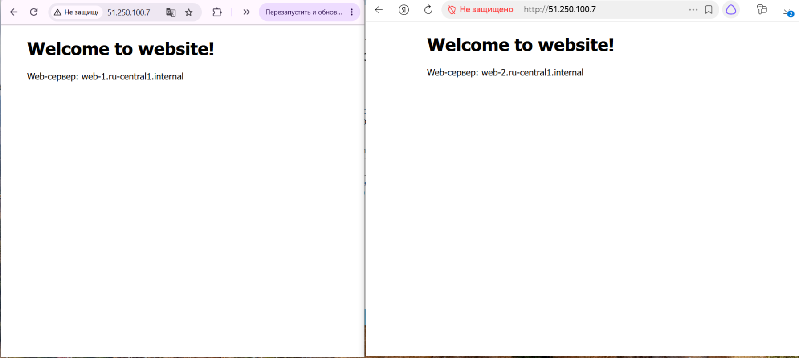
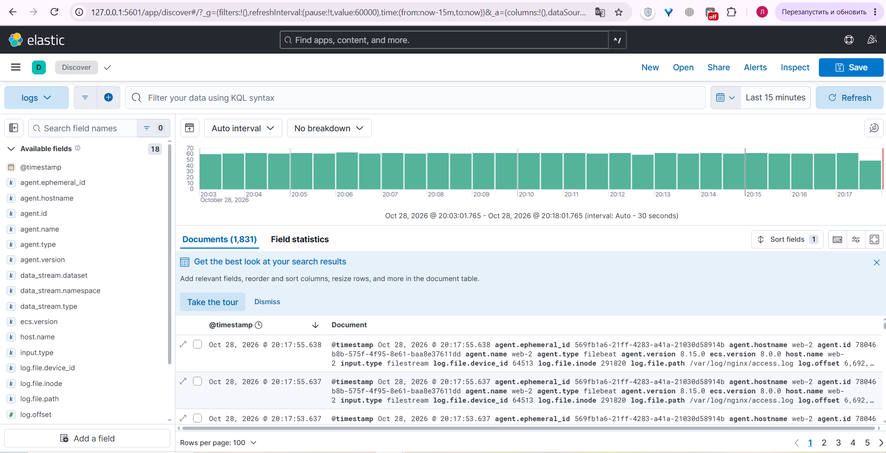
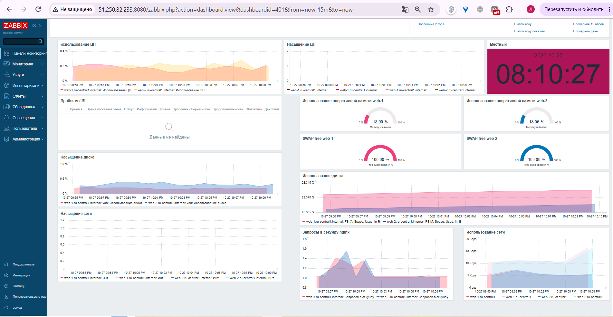
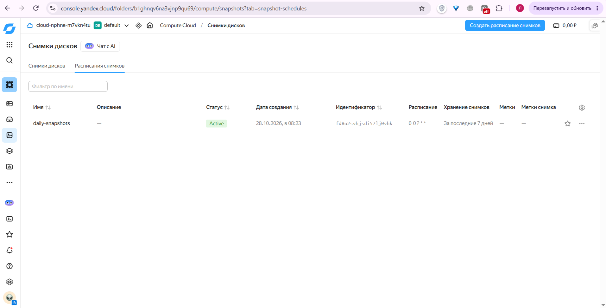

# Дипломная работа по профессии «Системный администратор» Фабричникова Т.А.

Описание

В данном проекте разработана отказоустойчивая инфраструктура для сайта, включающая мониторинг, сбор логов и резервное копирование основных данных. Инфраструктура размещается в Yandex Cloud.

## Этап 1. Сеть

Для bastion, kibana и zabbix делаем публичные подсети, с прямым доступом из интернета, для веб-серверов и elasticsearch, которые находятся в приватных подсетях, NAT стоит в false, нет публичного адреса, поэтому таблица маршрутизации для выхода в интернет через NAT-шлюз.

Файл network.tf:

```
resource "yandex_vpc_network" "cloud-net" {
  name = "cloud-net"
}
resource "yandex_vpc_subnet" "public-zone-a" {
  name           = "public-zone-a"
  zone           = "ru-central1-a"
  network_id     = yandex_vpc_network.cloud-net.id
  v4_cidr_blocks = ["10.10.1.0/24"]
}
resource "yandex_vpc_subnet" "private-zone-a" {
  name           = "private-zone-a"
  zone           = "ru-central1-a"
  network_id     = yandex_vpc_network.cloud-net.id
  v4_cidr_blocks = ["10.10.2.0/24"]
  route_table_id = yandex_vpc_route_table.private-rout.id
}
resource "yandex_vpc_subnet" "private-zone-d" {
  name           = "private-zone-d"
  zone           = "ru-central1-d"
  network_id     = yandex_vpc_network.cloud-net.id
  v4_cidr_blocks = ["10.10.3.0/24"]
  route_table_id = yandex_vpc_route_table.private-rout.id
}
resource "yandex_vpc_gateway" "nat-gateway" {
  name = "nat-gateway"
  shared_egress_gateway {}
}
resource "yandex_vpc_route_table" "private-rout" {
  name       = "private-rout"
  network_id = yandex_vpc_network.cloud-net.id

  static_route {
    destination_prefix = "0.0.0.0/0"
    gateway_id         = yandex_vpc_gateway.nat-gateway.id
  }
}
resource "yandex_vpc_subnet" "public-zone-e" {
  name           = "public-zone-e"
  zone           = "ru-central1-e"
  network_id     = yandex_vpc_network.cloud-net.id
  v4_cidr_blocks = ["10.10.4.0/24"]
}


resource "yandex_vpc_subnet" "private-zone-e" {
  name           = "private-zone-e"
  zone           = "ru-central1-e"
  network_id     = yandex_vpc_network.cloud-net.id
  v4_cidr_blocks = ["10.10.5.0/24"]
  route_table_id = yandex_vpc_route_table.private-rout.id
}
resource "yandex_vpc_subnet" "public-zone-d" {
  name           = "public-zone-d"
  zone           = "ru-central1-d"
  network_id     = yandex_vpc_network.cloud-net.id
  v4_cidr_blocks = ["10.10.6.0/24"]
}

```


✅ Развернут один VPC cloud-net.

✅ Созданы публичные и приватные подсети в зонах ru-central1-a, ru-central1-d и ru-central1-e. (в коде остались блоки public-zone-d и public-zone-e. Они создавались как резервные, когда из-за аварии в Yandex Cloud зона a была недоступна, и роль bastion временно выполняла Kibana)

✅ Настроен NAT-шлюз  и таблица маршрутизации (private-rout), чтобы приватные машины имели исходящий доступ в интернет.

## Этап 2. Настройка безопасности


Создан файл security.tf. Настроены 6 групп безопасности (Security Groups):


```
resource "yandex_vpc_security_group" "bastion-security-group" {
  name       = "bastion-security-group"
  network_id = yandex_vpc_network.cloud-net.id

  ingress {
    protocol       = "TCP"         #cнаружи можно подключаться по SSH с любых IP-адресов по 22 порту
    port           = 22
    v4_cidr_blocks = ["0.0.0.0/0"]
  }

  egress {
    protocol       = "ANY"   #исходящий трафик по любому протоколу куда угодно
    v4_cidr_blocks = ["0.0.0.0/0"]
  }
}

resource "yandex_vpc_security_group" "web-security-group" {
  name       = "web-security-group"
  network_id = yandex_vpc_network.cloud-net.id

  ingress {
    protocol          = "TCP"   # снаружи можно подключаться по TCP :80 только от балансировщика alb
    port              = 80
    security_group_id = yandex_vpc_security_group.alb-security-group.id
  }

  ingress {
    protocol          = "TCP"   # снаружи можно подключаться по TCP :80  от healthcheck
    port              = 80
    v4_cidr_blocks = ["198.18.235.0/24", "198.18.248.0/24"]
  }

  ingress {
    protocol          = "TCP"  # входящий трафик по протоколу TCP порт22 (SSH) от бастиона
    port              = 22
    security_group_id = yandex_vpc_security_group.bastion-security-group.id
  }

  ingress {
    protocol          = "TCP"  # входящий трафик по протоколу TCP порт22 (SSH) от кибана
    port              = 22
    security_group_id = yandex_vpc_security_group.kibana-security-group.id
  }

  ingress {
    protocol          = "TCP"  # входящий трафик по протоколу TCP порт 10050  от zabbix
    port              = 10050
    security_group_id = yandex_vpc_security_group.zabbix-security-group.id
  }

   ingress {
    protocol          = "TCP"  # входящий трафик по протоколу TCP порт 80  от zabbix
    port              = 80
    security_group_id = yandex_vpc_security_group.zabbix-security-group.id
  }


  egress {
    protocol       = "ANY"   # исходящий трафик по любому протоколу куда угодно
    v4_cidr_blocks = ["0.0.0.0/0"]
  }
}

resource "yandex_vpc_security_group" "zabbix-security-group" {
  name       = "zabbix-security-group"
  network_id = yandex_vpc_network.cloud-net.id

  ingress {
    protocol       = "TCP"  # снаружи можно подключаться по TCP :80 со всех ip-адресов
    port           = 80
    v4_cidr_blocks = ["0.0.0.0/0"]
  }

   ingress {
    protocol       = "TCP"  # входящий трафик по TCP :8080 для веб-интерфейса Zabbix
    port           = 8080
    v4_cidr_blocks = ["0.0.0.0/0"]
  }

  ingress {
    protocol          = "TCP"  # снаружи можно подключаться по TCP :22 (SSH) только от бастиона
    port              = 22
    security_group_id = yandex_vpc_security_group.bastion-security-group.id
  }

  ingress {
    protocol          = "TCP"   # входящий трафик по протоколу TCP порт 10051  от веб-серверов
    port              = 10051
    v4_cidr_blocks = ["10.10.2.0/24", "10.10.3.0/24","10.10.5.0/24"]
  }

  egress { 
    protocol       = "ANY"   # исходящий трафик по любому протоколу куда угодно
    v4_cidr_blocks = ["0.0.0.0/0"]
  }
}

resource "yandex_vpc_security_group" "elasticsearch-security-group" {
  name       = "elasticsearch-security-group"
  network_id = yandex_vpc_network.cloud-net.id

  ingress {
    protocol          = "TCP"  # входящий трафик по TCP :9200 от kibana
    port              = 9200
    security_group_id = yandex_vpc_security_group.kibana-security-group.id
  }

  ingress {
    protocol          = "TCP" # входящий трафик по TCP :9200 от веб-серверов
    port              = 9200  
    security_group_id = yandex_vpc_security_group.web-security-group.id
  }

  ingress {
    protocol          = "TCP"  # входящий трафик по TCP :22 от бастиона
    port              = 22
    security_group_id = yandex_vpc_security_group.bastion-security-group.id
  }

  ingress {
    protocol          = "TCP"  # входящий трафик по TCP :22 от кибана
    port              = 22
    security_group_id = yandex_vpc_security_group.kibana-security-group.id
  }

  egress {
    protocol       = "ANY"   # исходящий трафик по любому протоколу куда угодно
    v4_cidr_blocks = ["0.0.0.0/0"]
  }
}


resource "yandex_vpc_security_group" "kibana-security-group" {
  name       = "kibana-security-group"
  network_id = yandex_vpc_network.cloud-net.id

  ingress {
    protocol       = "TCP"  # входящий трафик по TCP :5601 с любых ip-адресов
    port           = 5601
    v4_cidr_blocks = ["0.0.0.0/0"]
  }

  ingress {
    protocol          = "TCP"  # входящий трафик по TCP :22 (SSH) от бастиона
    port              = 22
    security_group_id = yandex_vpc_security_group.bastion-security-group.id
  }
  ingress {
    description    = "SSH from my IP"
    protocol       = "TCP"
    port           = 22
    v4_cidr_blocks = ["178.207.165.90/32"]
  }
  egress {
    protocol       = "ANY"   # исходящий трафик по любому протоколу куда угодно
    v4_cidr_blocks = ["0.0.0.0/0"]
  }
}

resource "yandex_vpc_security_group" "alb-security-group" {
  name       = "alb-security-group"
  network_id = yandex_vpc_network.cloud-net.id

  ingress {
    protocol       = "TCP"   # входящий трафик по TCP :80 с любых ip-адресов
    port           = 80
    v4_cidr_blocks = ["0.0.0.0/0"]
  }

  ingress {
    protocol       = "TCP"  # входящий трафик по TCP :30080 c ip-адресов yandex cloud для проверок
    port           = 30080
    v4_cidr_blocks = ["198.18.235.0/24", "198.18.248.0/24"]
  }

  egress {
    protocol       = "ANY"   # исходящий трафик по любому протоколу куда угодно
    v4_cidr_blocks = ["0.0.0.0/0"]
  }
}

```

P.S.  В группах безопасности web и elasticsearch добавлены правила для SSH-подключений от Kibana, и для подключение по ssh:22 c моего ПК к kibana. Это было также сделано на время аварии в Yandex Cloud, когда зона a (где находится Bastion) была недоступна, и Kibana временно выполняла роль Bastion. После восстановления зоны эти правила можно удалить, оставила для наглядности, и на всяки случай)

Описание групп безопасности:

 - bastion-security-group — разрешает SSH (22) из интернета (для единственной точки входа).

 - web-security-group — разрешает HTTP (80) только от балансировщика (ALB) и проверок Yandex Cloud, а также SSH (22) от Bastion и Kibana, и Zabbix Agent (10050) от сервера Zabbix.

 - zabbix-security-group — разрешает веб-интерфейс (80, 8080) из интернета, SSH (22) от Bastion, и приём метрик (10051) от веб-серверов.

 - elasticsearch-security-group — разрешает API Elasticsearch (9200) только от Kibana и веб-серверов (Filebeat), и SSH (22) от Bastion/Kibana.

 - kibana-security-group — разрешает веб-интерфейс Kibana (5601) из интернета и SSH (22) от Bastion.

 - alb-security-group — разрешает HTTP (80) из интернета и healthcheck (30080) от Yandex Cloud.

## Этап 3. Создание виртуальных машин 

Создан файл vm.tf. Развернуто 6 ВМ на базе ОС Ubuntu 22.04 LTS.

Параметры: 2 ядра (20% vCPU), 2 ГБ RAM, 10 ГБ HDD - для всех ВМ одинаковые.

Bastion: Публичный IP, единственная точка входа для управления.

Web-1 / Web-2: Приватные IP, в разных зонах доступности (для отказоустойчивости).

Zabbix, Kibana: Публичные IP.

Elasticsearch: Приватный IP.

Примечание: В vm.tf добавлен блок lifecycle , чтобы обновление образов в Yandex Cloud не приводило к пересозданию машин, т.к неоднократно в процессе работы над дипломным проектом  приходилось заново настраивать ключи, класть пакеты и файлы ansible.

```
data "yandex_compute_image" "ubuntu" {
  family = "ubuntu-2204-lts"
}


resource "yandex_compute_instance" "bastion" {
  name        = "bastion"
  hostname    = "bastion"
  platform_id = "standard-v3"
  zone        = "ru-central1-a"

  resources {
    cores         = 2
    memory        = 2
    core_fraction = 20
  }

  boot_disk {
    initialize_params {
      image_id = data.yandex_compute_image.ubuntu.id
      size     = 10
      type     = "network-hdd"
    }
  }

  network_interface {
    subnet_id          = yandex_vpc_subnet.public-zone-a.id
    nat                = true
    security_group_ids = [yandex_vpc_security_group.bastion-security-group.id]
  }

  metadata = {
    ssh-keys = "ubuntu:${file("~/.ssh/id_ed25519.pub")}"
  }

  scheduling_policy {
    preemptible = true
  }
  
  lifecycle {
    ignore_changes = [boot_disk[0].initialize_params[0].image_id]
  }

}
resource "yandex_compute_instance" "web-1" {
  name        = "web-1"
  hostname    = "web-1"
  platform_id = "standard-v3"
  zone        = "ru-central1-e"

  resources {
    cores         = 2
    memory        = 2
    core_fraction = 20
  }

  boot_disk {
    initialize_params {
      image_id = data.yandex_compute_image.ubuntu.id
      size     = 10
      type     = "network-hdd"
    }
  }

  network_interface {
    subnet_id          = yandex_vpc_subnet.private-zone-e.id
    nat                = false
    security_group_ids = [yandex_vpc_security_group.web-security-group.id]
  }

  metadata = {
    user-data = file("cloud-init.yml")
  }

  scheduling_policy {
    preemptible = true
  }

   lifecycle {
    ignore_changes = [boot_disk[0].initialize_params[0].image_id]
  }
}
resource "yandex_compute_instance" "web-2" {
  name        = "web-2"
  hostname    = "web-2"
  platform_id = "standard-v3"
  zone        = "ru-central1-d"

  resources {
    cores         = 2
    memory        = 2
    core_fraction = 20
  }

  boot_disk {
    initialize_params {
      image_id = data.yandex_compute_image.ubuntu.id
      size     = 10
      type     = "network-hdd"
    }
  }

  network_interface {
    subnet_id          = yandex_vpc_subnet.private-zone-d.id
    nat                = false
    security_group_ids = [yandex_vpc_security_group.web-security-group.id]
  }

  metadata = {
    user-data = file("cloud-init.yml")
  }

  scheduling_policy {
    preemptible = true
  }

  lifecycle {
    ignore_changes = [boot_disk[0].initialize_params[0].image_id]
  }
}
resource "yandex_compute_instance" "zabbix" {
  name        = "zabbix"
  hostname    = "zabbix"
  platform_id = "standard-v3"
  zone        = "ru-central1-a"

  resources {
    cores         = 2
    memory        = 2
    core_fraction = 20
  }

  boot_disk {
    initialize_params {
      image_id = data.yandex_compute_image.ubuntu.id
      size     = 10
      type     = "network-hdd"
    }
  }

  network_interface {
    subnet_id          = yandex_vpc_subnet.public-zone-a.id
    nat                = true
    security_group_ids = [yandex_vpc_security_group.zabbix-security-group.id]
  }

  metadata = {
        user-data = file("cloud-init.yml")
  }

  scheduling_policy {
    preemptible = true
  }

  lifecycle {
    ignore_changes = [boot_disk[0].initialize_params[0].image_id]
  }
}
resource "yandex_compute_instance" "kibana" {
  name        = "kibana"
  hostname    = "kibana"
  platform_id = "standard-v3"
  zone        = "ru-central1-d"

  resources {
    cores         = 2
    memory        = 2
    core_fraction = 20
  }

  boot_disk {
    initialize_params {
      image_id = data.yandex_compute_image.ubuntu.id
      size     = 10
      type     = "network-hdd"
    }
  }

  network_interface {
    subnet_id          = yandex_vpc_subnet.public-zone-d.id
    nat                = true
    security_group_ids = [yandex_vpc_security_group.kibana-security-group.id]
  }

  metadata = {
       user-data = file("cloud-init.yml")
  }

  scheduling_policy {
    preemptible = true
  }

  lifecycle {
    ignore_changes = [boot_disk[0].initialize_params[0].image_id]
  }
}

resource "yandex_compute_instance" "elasticsearch" {
  name        = "elasticsearch"
  hostname    = "elasticsearch"
  platform_id = "standard-v3"
  zone        = "ru-central1-e"

  resources {
    cores         = 2
    memory        = 2
    core_fraction = 20
  }

  boot_disk {
    initialize_params {
      image_id = data.yandex_compute_image.ubuntu.id
      size     = 10
      type     = "network-hdd"
    }
  }

  network_interface {
    subnet_id          = yandex_vpc_subnet.private-zone-e.id
    nat                = false
    security_group_ids = [yandex_vpc_security_group.elasticsearch-security-group.id]
  }

  metadata = {
    user-data = file("cloud-init.yml")
  }

  scheduling_policy {
    preemptible = true
  }

  lifecycle {
    ignore_changes = [boot_disk[0].initialize_params[0].image_id]
  }
}

```

```
user@DESKTOP-4TF0VBB MINGW64 ~/diplom/terraform
$ yc compute instance list
+----------------------+---------------+---------------+---------+-----------------+-------------+
|          ID          |     NAME      |    ZONE ID    | STATUS  |   EXTERNAL IP   | INTERNAL IP |
+----------------------+---------------+---------------+---------+-----------------+-------------+
| bg06mpljgpotu6kvq2u1 | web-1         | ru-central1-e | RUNNING |                 | 10.10.5.10  |
| bg0l3bh8bq3h3alo0jbr | elasticsearch | ru-central1-e | RUNNING |                 | 10.10.5.11  |
| fhma3jhmu3m4ekija1hi | zabbix        | ru-central1-a | RUNNING | 51.250.81.176   | 10.10.1.13  |
| fhmupfphvi7vuhjj8o59 | bastion       | ru-central1-a | RUNNING | 51.250.12.204   | 10.10.1.18  |
| fv44fb8jpf1g4rrbsgep | kibana        | ru-central1-d | RUNNING | 158.160.245.233 | 10.10.6.16  |
| fv4nnkputu01372484i3 | web-2         | ru-central1-d | RUNNING |                 | 10.10.3.32  |
+----------------------+---------------+---------------+---------+-----------------+-------------+
```
Машины успешно запущены.

## Этап 4. Настройка балансировщика

 - Первым этапом был созданы плейбуки, для установки на веб-сервера nginx, и подмены html шаблона на индивидуальный для каждого сервера. Также создан inventory.ini с FQDN именами машин (без IP-адресов).

 inventory.ini:


```
 [web]
web-1.ru-central1.internal
web-2.ru-central1.internal

[elasticsearch]
elasticsearch.ru-central1.internal

[zabbix]
zabbix.ru-central1.internal

[kibana]
kibana.ru-central1.internal
```


 playbook.yml

```
---
- name: Install Nginx
  hosts: web
  become: yes
  tasks:
    - name: Install Nginx
      apt:
        name: nginx
        state: present
        update_cache: yes

    - name: Start Nginx
      service:
        name: nginx
        state: started
        enabled: yes
```

playbook-site.yml

```
---
- name: Развертывание сайта
  hosts: web
  become: yes

  tasks:
    - name: Копирование стартовой страницы
      template:
        src: files/index.html.j2
        dest: /var/www/html/index.html
        owner: www-data
        group: www-data
        mode: '0644'

    - name: Restart nginx to apply changes
      service:
        name: nginx
        state: restarted
 
 ```


 - Создан файл alb.tf. Настроен Application Load Balancer:

   - Создана Target Group, в которую включены web-1 и web-2.

   - Создана Backend Group с проверкой здоровья (healthcheck) на / и порт 80.

   - Создан HTTP Router и Virtual Host для маршрутизации запросов.

   - Создан ALB с публичным IP и слушающий на порту 80.

```
resource "yandex_alb_target_group" "target-group" {   # обозначаем цели
  name = "target-group"

  target {
    subnet_id  = yandex_vpc_subnet.private-zone-e.id
    ip_address = yandex_compute_instance.web-1.network_interface[0].ip_address
  }

  target {
    subnet_id  = yandex_vpc_subnet.private-zone-d.id
    ip_address = yandex_compute_instance.web-2.network_interface[0].ip_address
  }
}


resource "yandex_alb_backend_group" "backend-group" {   # обработка входящего трафика и проверка здоровья
  name = "backend-group"

  http_backend {
    name             = "web-backend"
    port             = 80
    target_group_ids = [yandex_alb_target_group.target-group.id]

    healthcheck {
      timeout  = "1s"
      interval = "2s"
      http_healthcheck {
        path = "/"
      }
    }
  }
}

resource "yandex_alb_http_router" "web-router" {  # настройка роутера и маршрутизации
  name = "web-router"
}

resource "yandex_alb_virtual_host" "web-virtual-host" {
  name           = "web-virtual-host"
  http_router_id = yandex_alb_http_router.web-router.id

  route {
    name = "route"
    http_route {
      http_route_action {
        backend_group_id = yandex_alb_backend_group.backend-group.id
      }
    }
  }
}

resource "yandex_alb_load_balancer" "web-alb" {  # настройка балансировщика
  name        = "web-alb"
  network_id  = yandex_vpc_network.cloud-net.id
  security_group_ids = [yandex_vpc_security_group.alb-security-group.id]

  allocation_policy {
    location {
      zone_id   = "ru-central1-d"
      subnet_id = yandex_vpc_subnet.public-zone-d.id
    }
  }

  listener {
    name = "web-listener"
    endpoint {
      address {
        external_ipv4_address {}
      }
      ports = [80]
    }
    http {
      handler {
        http_router_id = yandex_alb_http_router.web-router.id
      }
    }
  }
}

```

**Сайт (через балансировщик):** [http://51.250.100.7](http://51.250.100.7)


>Демонстрация работы сайта и балансировщика c терминала



>Демонстрация работы сайта и балансировщика c браузера

## Этап 5. Настройка серверов через Ansible, развертывание Elasticsearch и Kibana, настройка и установка filebeat. 

Для управления конфигурацией использовался Ansible, запускаемый с Bastion.

Настроен Filebeat на веб-серверах для отправки логов Nginx (access.log, error.log) в Elasticsearch:

  - На хостовой ПК скачан deb. пакет filebeat.deb и с помощью команты `scp` , как и все файлы ansible, скопирован на bastion.
  - Создан плейбук playbook-filebeat.yml

```
---
- name: Install Filebeat from local deb
  hosts: web
  become: yes
  tasks:
    - name: Copy Filebeat deb to servers
      copy:
        src: /home/ubuntu/filebeat.deb
        dest: /tmp/filebeat.deb

    - name: Install Filebeat package
      apt:
        deb: /tmp/filebeat.deb

    - name: Configure Filebeat to read Nginx logs and send to Elasticsearch
      copy:
        dest: /etc/filebeat/filebeat.yml
        content: |
          filebeat.inputs:
          - type: filestream
            id: nginx-access
            enabled: true
            paths:
              - /var/log/nginx/access.log
          - type: filestream
            id: nginx-error
            enabled: true
            paths:
              - /var/log/nginx/error.log
          
          output.elasticsearch:
            hosts: ["http://elasticsearch.ru-central1.internal:9200"]
    
    - name: Start and enable Filebeat
      service:
        name: filebeat
        state: started
        enabled: yes

```

  - Установка  Elasticsearch : deb пакет скачать не удалось, поэтому установка производилась с помощью докер-контейнера. Дополнила playbook.yml:

```
- name: Install Elasticsearch whith Docker
  hosts: elasticsearch
  become: yes
  tasks:
    - name: Install Docker and Python SDK
      apt:
        name:
          - docker.io
          - python3-pip
        state: present
        update_cache: yes

    - name: Install Docker SDK for Python
      pip:
        name: docker

    - name: Start Docker
      service:
        name: docker
        state: started
        enabled: yes

    - name: Run Elasticsearch container
      docker_container:
        name: elasticsearch
        image: docker.elastic.co/elasticsearch/elasticsearch:8.15.0
        state: started
        restart_policy: always
        ports:
          - "9200:9200"
        env:
          discovery.type: "single-node"
          xpack.security.enabled: "false"
          ES_JAVA_OPTS: "-Xms512m -Xmx512m"  

```

  - На пк скачан deb. пакет kibana, и установлен на вм kibana с помощью playbook-kibana.yml

```
---
- name: Install Kibana from local deb
  hosts: kibana
  become: yes
  tasks:
    - name: Copy Kibana deb to server
      copy:
        src: /home/ubuntu/kibana.deb
        dest: /tmp/kibana.deb

    - name: Install Kibana package
      apt:
        deb: /tmp/kibana.deb

    - name: Configure Kibana to connect to Elasticsearch
      lineinfile:
        path: /etc/kibana/kibana.yml
        regexp: '^#?elasticsearch.hosts:'
        line: 'elasticsearch.hosts: ["http://elasticsearch.ru-central1.internal:9200"]'

    - name: Allow external connections to Kibana
      lineinfile:
        path: /etc/kibana/kibana.yml
        regexp: '^#?server.host:'
        line: 'server.host: "0.0.0.0"'

    - name: Start and enable Kibana
      service:
        name: kibana
        state: started
        enabled: yes
```


Kibana настроена на подключение к Elasticsearch и прослушивание всех интерфейсов (SERVER_HOST=0.0.0.0).

В Kibana (раздел Discover) создан Data View filebeat-*. Логи Nginx с обоих веб-серверов успешно поступают в Elasticsearch и отображаются в интерфейсе:


>Демонстрация работы веб интерфейса kibana в elasticsearch

Примечание:  На скрине кибана открыта по адресу localhost:5601. Еще вчера все открывалось по адресу http://158.160.245.233:5601 , но сегодня почему то открывается только если пробросить туннель с хоста до кибаны через бастион, может связанно как то с еще существующими ограничениями в YC, но служба на kibana в статусе active, конфигурационный файл не менялся, правильный, правила безопасности прописаны для подключения к кибане с любых ip по порту 5601, я так и не поняла в чем причина.


## Этап 6. Мониторинг Zabbix 
*   На ВМ zabbix через Ansible-плейбук  установлены:
    -   Zabbix Server и Zabbix Web Frontend
    -   PostgreSQL в качестве базы данных.
    -   Nginx 
    -   Zabbix Agent 2 установлен на все остальные ВМ (web-1, web-2, elasticsearch, kibana) также через Ansible. Настроены параметры Server и Hostname для связи с сервером.

```
---
- name: Install Zabbix Server with PostgreSQL
  hosts: zabbix
  become: yes
  vars:
    db_password: "zabbix" 

  tasks:
    - name: Download Zabbix repository
      get_url:
        url: https://repo.zabbix.com/zabbix/7.0/ubuntu/pool/main/z/zabbix-release/zabbix-release_latest_7.0+ubuntu22.04_all.deb
        dest: /tmp/zabbix-release.deb

    - name: Install Zabbix repository
      apt:
        deb: /tmp/zabbix-release.deb

    - name: Update apt cache
      apt:
        update_cache: yes

    - name: Install Zabbix server, frontend, agent
      apt:
        name:
          - zabbix-server-pgsql
          - zabbix-frontend-php
          - php8.1-pgsql
          - zabbix-nginx-conf
          - zabbix-sql-scripts
          - zabbix-agent2
        state: present

    - name: Install PostgreSQL
      apt:
        name:
          - postgresql
          - postgresql-contrib
          - python3-psycopg2
        state: present

    - name: Ensure PostgreSQL is running
      service:
        name: postgresql
        state: started
        enabled: yes

    - name: Create Zabbix database user
      community.postgresql.postgresql_user:
        name: zabbix
        password: "{{ db_password }}"
        role_attr_flags: LOGIN
      become_user: postgres

    - name: Create Zabbix database
      community.postgresql.postgresql_db:
        name: zabbix
        owner: zabbix
      become_user: postgres

    - name: Import initial schema
      shell: |
        zcat /usr/share/zabbix-sql-scripts/postgresql/server.sql.gz | psql -U zabbix -d zabbix
      environment:
        PGPASSWORD: "{{ db_password }}"
      args:
        creates: /var/lib/postgresql/.zabbix_schema_imported 
      become_user: zabbix

    - name: Configure Zabbix server database password
      lineinfile:
        path: /etc/zabbix/zabbix_server.conf
        regexp: '^# DBPassword='
        line: "DBPassword={{ db_password }}"

    - name: Configure Nginx for Zabbix
      lineinfile:
        path: /etc/nginx/conf.d/zabbix.conf
        regexp: '^\s*#?\s*listen\s+8080;'
        line: '        listen          8080;'
        insertafter: 'server {'

    - name: Start and enable Zabbix server, agent, nginx, php-fpm
      service:
        name: "{{ item }}"
        state: started
        enabled: yes
      loop:
        - zabbix-server
        - zabbix-agent2
        - nginx
        - php8.1-fpm

  handlers:
    - name: restart nginx
      service:
        name: nginx
        state: restarted

- name: Install Zabbix Agent 2 on all other hosts
  hosts: web:elasticsearch:kibana
  become: yes
  tasks:
    - name: Download Zabbix repository
      get_url:
        url: https://repo.zabbix.com/zabbix/7.0/ubuntu/pool/main/z/zabbix-release/zabbix-release_latest_7.0+ubuntu22.04_all.deb
        dest: /tmp/zabbix-release.deb

    - name: Install Zabbix repository
      apt:
        deb: /tmp/zabbix-release.deb

    - name: Update apt cache
      apt:
        update_cache: yes

    - name: Install Zabbix Agent 2
      apt:
        name: zabbix-agent2
        state: present

    - name: Configure Zabbix Agent (Server IP)
      lineinfile:
        path: /etc/zabbix/zabbix_agent2.conf
        regexp: '^Server='
        line: 'Server=10.10.1.13' # Внутренний IP машины Zabbix

    - name: Configure Zabbix Agent (ServerActive)
      lineinfile:
        path: /etc/zabbix/zabbix_agent2.conf
        regexp: '^ServerActive='
        line: 'ServerActive=10.10.1.13'

    - name: Configure Hostname
      lineinfile:
        path: /etc/zabbix/zabbix_agent2.conf
        regexp: '^Hostname='
        line: "Hostname={{ inventory_hostname }}"

    - name: Start and enable Zabbix Agent 2
      service:
        name: zabbix-agent2
        state: started
        enabled: yes

```

    - В веб-интерфейсе Zabbix настроены хосты, и создан дашборд по принципу USE:
        - Utilization: CPU, Memory, Nginx Requests per second.
        - Saturation: Load Average, Available Memory, Active connections.
        - Errors: Виджет «Problems» (срабатывание триггеров).
        - На графики добавлены Thresholds (пороги 80%, 90%, 100%).


>Демонстрация работы веб интерфейса zabbix http://51.250.81.176:8080/


## Этап 7. Резервное копирование 

Создан файл snapshots.tf.

Настроено ежедневное создание снимков дисков (Snapshots) для всех 6 ВМ (cron: 0 0 ? * *).

Настроено ограничение времени жизни снимков — 1 неделя (168h).

```
resource "yandex_compute_snapshot_schedule" "daily-snapshots" {
  name = "daily-snapshots"

  # Расписание: каждый день в 02:00 ночи (UTC)
  schedule_policy {
    expression = "0 0 ? * *" 
  }

  retention_period = "168h" 
  
  disk_ids = [
    yandex_compute_instance.bastion.boot_disk[0].disk_id,
    yandex_compute_instance.web-1.boot_disk[0].disk_id,
    yandex_compute_instance.web-2.boot_disk[0].disk_id,
    yandex_compute_instance.zabbix.boot_disk[0].disk_id,
    yandex_compute_instance.kibana.boot_disk[0].disk_id,
    yandex_compute_instance.elasticsearch.boot_disk[0].disk_id,
  ]
}
```

>Снимки дисков

## Этап 8. Добавление ролей

Для более удобной организации кода можно множество плейбуков оформить в один с ролями. В репозитории добавлена папка roles, и итоговый плейбук playbook-final.yml


🔗 Ссылки для проверки

Сайт (через балансировщик): http://51.250.100.7

Zabbix: http://51.250.81.176:8080 (Admin / zabbix)

Kibana: http://158.160.245.233:5601


